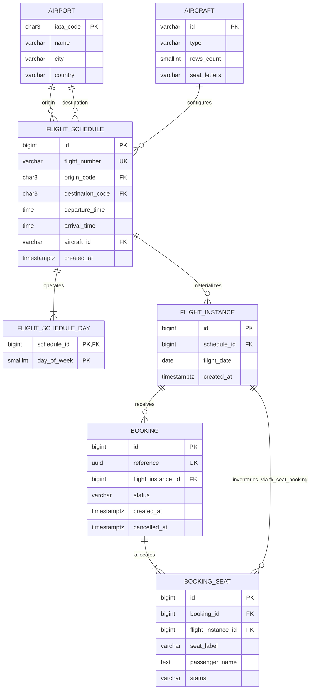

# Entity relationships

This diagram matches V1 and the generated `schema.sql`. Reference data is in V2;
the Flyway history table is operational metadata and is excluded from the snapshot.

The `|{` lower bounds describe application invariants: schedule creation includes
at least one day and booking includes at least one seat in one transaction.
Foreign keys alone do not enforce those minimum child counts.
`booking_seat` has no direct foreign key to `flight_instance`; its instance is
enforced through the composite `fk_seat_booking` described below.

## Keys and inventory invariants

`flight_instance(schedule_id,flight_date)` is unique. `booking(id,flight_instance_id)`
is additionally unique to support the composite allocation foreign key.
`booking_seat(booking_id,flight_instance_id)` references that pair, so an allocation
cannot silently belong to a different instance than its booking.

`uq_booking_seat_active` uniquely indexes `(flight_instance_id,seat_label)` **where
status is BOOKED**. Historical RELEASED rows can coexist with a newer active owner.
The fixed layout is derived from the aircraft's row count and seat letters; there
is no independently mutable seat inventory table/counter.

The route index supports search, the instance unique index supports instance
lookups, and `ix_seat_booking` supports cancellation/history lookup. V1 and the
snapshot contain complete check constraints, including UTC cancellation-state
consistency, canonical labels and valid weekdays.
