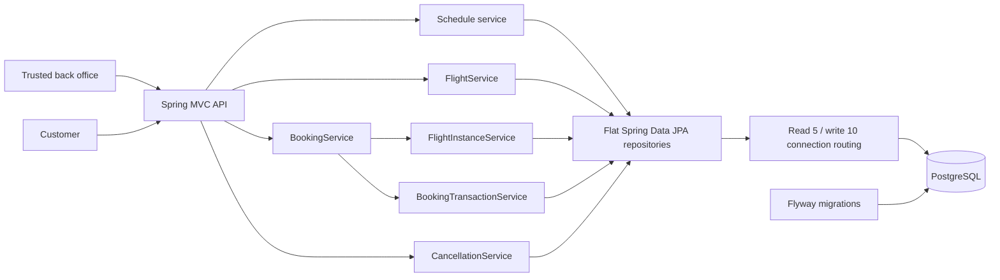

# High-level design

Implemented architecture: 2026-10-20. The nine functional requirements are covered by
API and PostgreSQL tests. Reviewer-startup and final delivery checks are tracked in the
execution log rather than inferred from this design.

## Requirements and scope

A single airline's back office creates immutable schedules. Customers search by
airports/date, inspect aircraft seat maps, book selected seats and cancel a booking.
Airports and aircraft are seeded, not managed through APIs. Bookings cover one flight.
The window contains 365 UTC dates starting today.

The clarified envelope is 10k DAU, 500 schedules, 25:1 search/booking traffic, a
one-second search target, and strongly consistent booking. Search may become stale if
the booking API explains a seat conflict. DAU alone does not establish a QPS estimate.

Out of scope: payments/refunds, pricing, notifications, user accounts, timezone
conversion, seat holds, partial cancellation, connecting flights, search sort/filter
controls and additional listing/retrieval APIs.

## Overall architecture and components



One Java 21 / Spring Boot deployable; PostgreSQL is its only external dependency.
The Java root uses conventional controller/service/repository/entity packages, separate
DTO request/response packages, `service.impl`, immutable application `model` records,
and configuration/exception/validation packages.
Packages are organized by layer, not by business feature.
MVC handles transport; services define business rules and transactions; Spring Data JPA
repositories handle persistence. Narrow service interfaces exchange application models,
not JPA entities or API DTOs. Controllers map transport records and implementations
map persistence objects internally. `repository/` contains flat Spring Data interfaces,
not pass-through adapters. This deliberately favors conventional layered Spring design
over a strictly persistence-independent core. Entities never become API response bodies.
Lombok supplies component constructors/logging and
entity getters. Explicit local types are used instead of `var`.

The same artifact may run behind a load balancer as multiple stateless instances.
The delivered Compose setup defaults to one application and one database. There are
no JVM-local seat locks, sessions, mutable seat caches, broker or leader-election jobs.
Admin authentication belongs to a trusted external boundary; this backend does not
implement it or pretend that an `/admin` URL authenticates callers.

## Service interactions and request flows

| Flow | Interaction and failure boundary |
|---|---|
| Create schedule | Controller -> schedule service -> reference checks -> schedule and day inserts in one transaction. Any failure rolls both back. |
| Search | Controller -> flight query -> one route/day aggregate including active allocation count. No writes. |
| Seat map | Resolve operating schedule/date -> read active labels -> derive complete configured map. Missing instance means fully available. |
| Book | Coordinator validates -> short materialization transaction commits -> booking transaction inserts booking and sorted allocations -> commit or full rollback. Known seat conflicts are reported after rollback. |
| Cancel | Lookup with instance/schedule -> check UTC departure/status -> read assigned labels -> conditional booking status update -> release all seats in one transaction. Release-count mismatch rolls everything back. |

All interactions are synchronous and in-process except database access. Separate
transactional beans make proxy boundaries explicit. Materialization is not nested in
the booking transaction and never needs a second simultaneous connection. The booking
coordinator rejects ambient transactions with `Propagation.NEVER` before persistence.
JSON negotiation occurs before controller invocation; strict HH:mm parsing prevents
invalid 24:00 clocks being normalized into midnight.

## Flight generation strategy

Hybrid generation projects bookable flights from immutable schedules and the requested
date. Reads do not enumerate a year or materialize missing rows. First booking creates
one instance with `UNIQUE(schedule_id, flight_date)`; later bookings reuse it.

Full materialization is allowed by the assignment and manageable at this scale, but
requires maintaining a rolling horizon. Dynamic-only storage is possible but complicates
allocation references. Hybrid keeps the rolling window a predicate while giving bookings
a stable foreign-key target.

## Concurrency strategy

The authoritative active-seat invariant is:

```sql
CREATE UNIQUE INDEX uq_booking_seat_active
    ON booking_seat (flight_instance_id, seat_label)
    WHERE status = 'BOOKED';
```

Canonical seat validation prevents alternate labels identifying the same seat.
Multi-seat inserts follow one deterministic order to reduce deadlock risk. Uniqueness
and atomic transactions prevent overselling across any number of application instances.
A seat conflict aborts the whole booking and returns 409; it is not retried as a transient
failure. READ COMMITTED is sufficient for this schema-enforced invariant.

Pessimistic/optimistic inventory locking are valid alternatives, but would add lockable
inventory rows or serialize unrelated seats through the parent flight. No availability
counter, `@Version`, distributed lock or reservation state is needed here.

Cancellation changes booking and allocation state atomically. Released historical rows
leave the partial index and allow reuse. A concurrent booker can succeed after release
commits or encounter the still-active owner; neither may produce partial allocation.

## Major design decisions and assumptions

See [the decision log](../features/ATS-1/decision-log.md) for alternatives.

- One immutable schedule per flight number is an explicit identity assumption.
- UTC schedule time plus UTC flight date defines departure. No airport-local inference.
- `[today, today + 365)` contains exactly 365 dates, including across leap years.
- Arrival time may precede departure time; the API does not compute duration/arrival date.
- Booking uses UUID references; passenger count is derived from seat allocations.
- The user selected 409 on repeat cancellation and on cancellation after departure.
- Spring Data JPA supplies repository operations and a JPQL search projection. The
  instance upsert is native SQL; database constraints remain authoritative. Flyway owns
  schema evolution; Hibernate validates it and OSIV is disabled.
- POST booking is not idempotent: a lost response can leave the caller without its
  reference. No extra recovery/idempotency API is claimed to exist.

## Operational limits and scale considerations

Pool acquisition timeout is not an end-to-end search deadline. Measure full HTTP latency
with 500 schedules and documented data/load. Query-count regressions and EXPLAIN help
diagnose performance; small-table sequential scans are legitimate.

Spring's `LazyConnectionDataSourceProxy` routes read-only search/maps to a dedicated
five-connection pool on the same primary: 250 ms acquisition, 500 ms PostgreSQL statement
timeout and 250 ms lock timeout. Ordinary transactions retain a separate ten-connection
pool and 20 s acquisition. Booking lookup/conflict enrichment use write capacity;
lookup within a read-only seat-map transaction joins that read transaction. Saturated
reads return explicit 503 rather than starving booking connections. Physical-pool
exhaustion and SQL/lock cancellation/recovery are exercised by `ReadIsolationIT`.
The combined maximum is 15 per replica, 45 for three against the local 100 limit.
Database budgets do not bound HTTP queueing, network or cold connection establishment.

Total replica pool demand must fit PostgreSQL's connection budget. A pooler, replicas,
cache or queue is a future option only when measurements justify it, not implemented
infrastructure. Live availability is snapshot-consistent, not a seat hold.
Readiness includes database connectivity, while liveness does not depend on the database.

Search projects four fields in one SQL statement without hydrating entities. An explicit
entity graph fetches the aircraft needed for flight resolution; a seat map then reads
active labels, with no per-seat query loop. IDENTITY-based seat saves execute individual
inserts in deterministic label order; `saveAllAndFlush` is not asserted to be batching.
Booking latency may vary under contention as allowed by the clarified requirements.

## Evidence and deployment boundaries

`CrossInstanceIT` runs two independent Spring web contexts, connection pools and HTTP
ports against one PostgreSQL primary. Concurrent same-seat POSTs produce one 201 and
one 409; either context can cancel and rebook the committed allocation. These are
independent contexts in one JVM, not a claim of a multi-host deployment benchmark.
Compose additionally permits separate JVM replicas using a host-port range. An
isolated three-container acceptance run produced one 201 and two 409s for the same
seat, followed by successful cancellation and rebooking through different JVMs.

The same test stops the database: liveness remains 200, readiness becomes 503 and
booking returns an explicit 503 with an unconfirmed-outcome warning. Health details
are not exposed to unauthenticated callers. Correlation identifiers are validated,
echoed and cleared from MDC after requests; passenger names and payloads are not logged.

Search was measured through real HTTP with 500 schedules and 600,000 synthetic
active/historical allocations. In the latest recorded full run (R2, 2026-10-21) the
eight-worker search p95 was 6.858 ms, and the 25:1 mixed run at 16/64/192 clients
measured search p95 12.515/32.393/97.293 ms. All 816 disjoint bookings succeeded; the
192-client phase shed 2 of 14,400 searches as explicit 503s. No measured search
exceeded one second. The phases lasted about 1/2/6 seconds, so this is not a sustained
capacity certification, and the mixed-load test fails intermittently with a connect-time
reset. See the [NFR evidence ledger](../tests/nfr-evidence.md) for every run and
condition, and [LLD](../lld/design.md#query-audit-and-measured-performance) for the
dataset, SQL plan and query costs. No lazy-loading API is presently necessary; if scale
changes, bounded pagination/lazy loading is a measured follow-up, not an existing
endpoint or unlimited-throughput claim.

The backend contains no authentication. Deployment must restrict the administrative
route at a trusted gateway; UUID references are identifiers, not an authorization
system. Payments and other excluded integrations are not called, so no fabricated
black-box client or static payment step is inserted into a booking.
