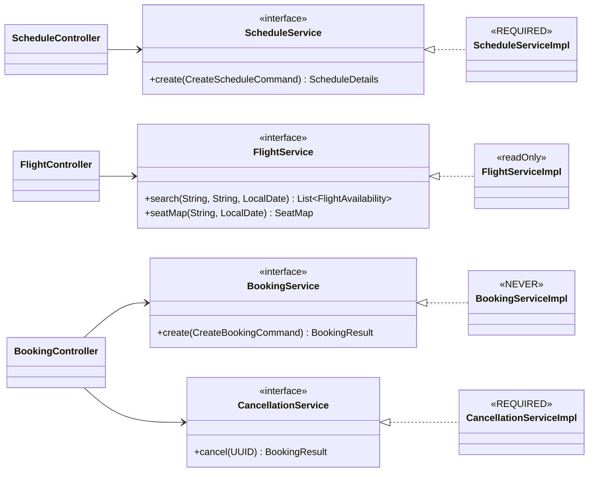
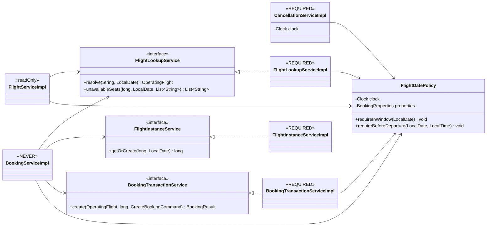
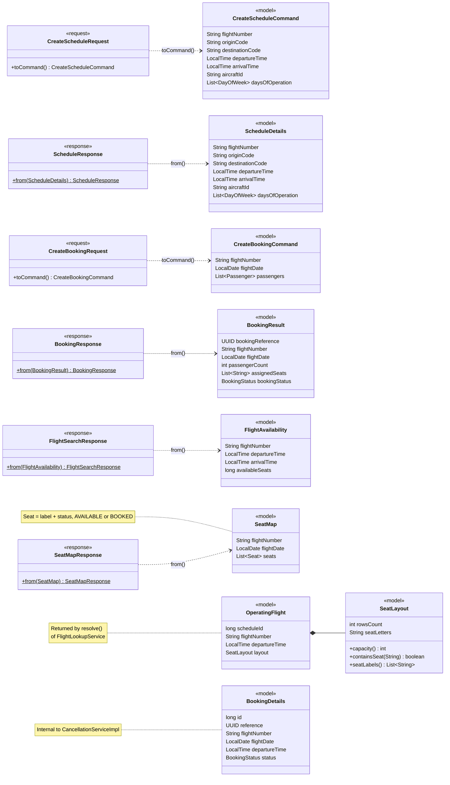
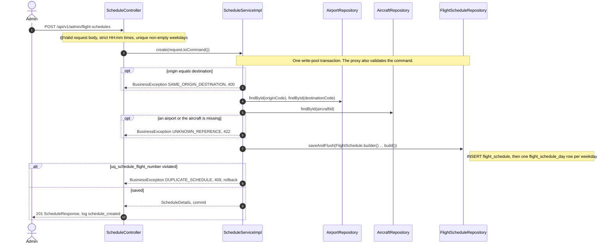
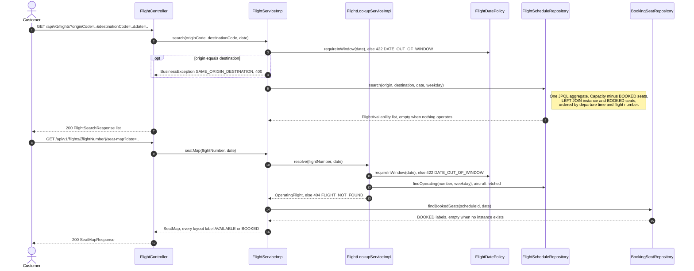
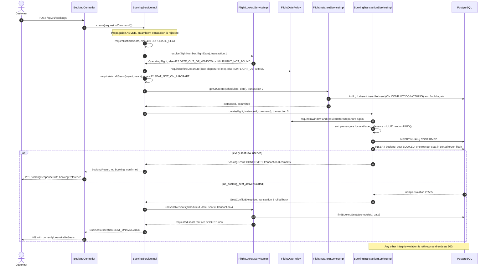
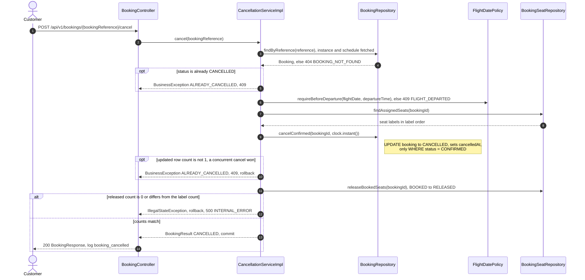
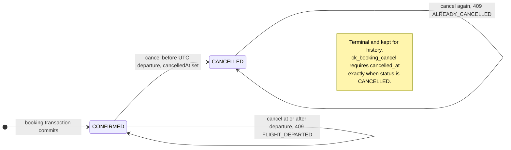
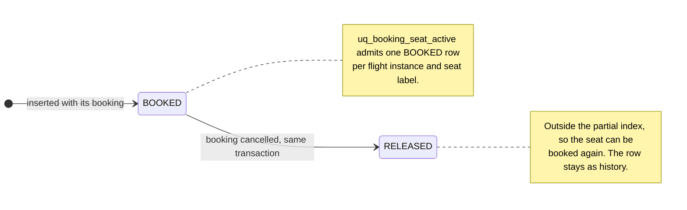

# Low-level design

Implemented design: 2026-10-20. [HLD](../hld/architecture.md) explains the major tradeoffs;
the execution log records acceptance evidence and remaining submission gates.

## Modules, packages, classes and services

The backend is one Maven module and one Spring Boot application; it does not use Java
Platform Module System modules. Its logical modules are the layer packages below. The
services are described after the table and drawn in LLD-1a and LLD-1b.

| Package | Responsibilities |
|---|---|
| `controller` | HTTP transport for schedules, flights and bookings |
| `service` | Narrow use-case interfaces and shared date policy |
| `service.impl` | Business rules, transactions and internal JPA mapping |
| `model` | Immutable commands/results, booking status, flight snapshots and shared seat-layout rules |
| `repository` | Spring Data JPA interfaces, projected queries and the instance upsert |
| `entity` | Airport, aircraft, schedule, instance, booking and seat mappings |
| `dto.request` | Specific validated schedule and booking request records |
| `dto.response` | Specific schedule, flight search, seat map and booking response records |
| `config` | UTC Clock, validated booking/read-pool properties, lazy datasource routing, weekday conversion and correlation filter |
| `exception` | Business codes/exceptions, persistence-constraint inspection and RFC 9457 handling |
| `validation` | Shared canonical input formats |

The Java root is organized by layer, not by feature. `controller` owns HTTP transport, `service` owns business rules and
transactions, `repository` contains Spring Data JPA interfaces, `entity` contains ORM
mappings, and `dto.request`/`dto.response` contain distinct records. Configuration,
exceptions and input patterns have root-level packages. Constructor injection is generated
by Lombok. Explicit local types are required; there are no `var` declarations.

`ScheduleServiceImpl` uses `FlightScheduleRepository`, `AirportRepository` and
`AircraftRepository`. `FlightServiceImpl` projects `FlightAvailability` and delegates
operating-flight snapshots to `FlightLookupService`, whose implementation uses an
explicit aircraft entity graph. `FlightInstanceServiceImpl` performs a native upsert and
separate ID lookup. `BookingServiceImpl` validates and coordinates without a transaction;
`BookingTransactionServiceImpl` persists the booking and ordered `BookingSeat` entities.
These two services are separate for transaction proxy correctness, not naming ceremony.
`CancellationServiceImpl` owns cancellation and release in a single transaction using
`BookingRepository` and `BookingSeatRepository`. `FlightDatePolicy` centralizes the
UTC horizon and exact departure cutoff. All seven service contracts have narrow interfaces;
collaborators inject those interfaces, not implementation classes. `FlightDatePolicy`
remains a concrete shared policy rather than a ceremonial interface pair.

The user selected conventional flat Spring Data repositories over the intermediate
ports/JPA-adapter split. Implementations may depend on JPA, but no public service
contract exchanges entities or transport DTOs. This is layered architecture, not a
persistence-independent application core. There are no pass-through repository wrappers.

Entities are internal persistence models; controllers expose `CreateScheduleRequest`,
`ScheduleResponse`, `CreateBookingRequest`, `BookingResponse`, `FlightSearchResponse`
and `SeatMapResponse`. No generic DTO is shared across unrelated use cases.
Controllers convert transport requests to commands and application results to response
DTOs. Search's JPQL constructor projects `model.FlightAvailability`, never an API DTO.
Shared `SeatLayout` rules are reused by aircraft entities and immutable operating-flight
snapshots. Application models have no Spring, Jackson or JPA dependencies. OSIV is disabled.
IDENTITY-generated seat IDs imply individual ordered inserts, not JDBC batching.
`reWriteBatchedInserts=true` in the JDBC URL therefore has no effect today; it only
matters after a move to sequence IDs. Seats are inserted in lexical label order
(`Comparator.comparing(seat)`, so `10A` precedes `2A`). Deadlock reduction only needs
a deterministic total order, not a numeric one.

### Class diagrams

Diagrams in this document are Mermaid source; rendered copies are indexed in
[hld/diagrams/README.md](../hld/diagrams/README.md).

**LLD-1a. Public contracts and implementations.** Controllers depend only on service
interfaces. Solid arrows are injected dependencies; a dashed arrow with a hollow head
points at the interface an implementation realizes. The stereotype on each
implementation is its `@Transactional` propagation (Spring's default is REQUIRED);
`readOnly` means REQUIRED with `readOnly = true`.

**LLD-1b. Internal collaborators.** `BookingServiceImpl` coordinates three internal
services so that lookup, instance creation and the booking insert each run in their own
transaction (see [Transaction boundaries](#transaction-boundaries)). `FlightDatePolicy`
is a shared `@Component`; it and `CancellationServiceImpl` read the injected UTC `Clock`.
Arrows and stereotypes follow LLD-1a.

Repository use by implementation (`BookingServiceImpl` uses no repository; it only
coordinates the services above):

| Implementation | Repository methods |
|---|---|
| `ScheduleServiceImpl` | `AirportRepository.findById` (origin, destination), `AircraftRepository.findById`, `FlightScheduleRepository.saveAndFlush` |
| `FlightServiceImpl` | `FlightScheduleRepository.search`, `BookingSeatRepository.findBookedSeats` |
| `FlightLookupServiceImpl` | `FlightScheduleRepository.findOperating`, `BookingSeatRepository.findBookedSeats` |
| `FlightInstanceServiceImpl` | `FlightInstanceRepository.findId`, `insertIfAbsent` |
| `BookingTransactionServiceImpl` | `FlightInstanceRepository.getReferenceById`, `BookingRepository.save`, `BookingSeatRepository.saveAllAndFlush` |
| `CancellationServiceImpl` | `BookingRepository.findByReference`, `cancelConfirmed`; `BookingSeatRepository.findAssignedSeats`, `releaseBookedSeats` |

**LLD-2. Repositories and JPA entities.** Every association is a unidirectional, lazy
`@ManyToOne`; the only entity collection is the schedule's weekday set. `BookingStatus`
lives in `model` because service results use it too. Tables, keys and constraints are
in the [ER diagram](../db/er-diagram.md).

```mermaid
classDiagram
    direction LR
    class AirportRepository {
        <<JpaRepository>>
    }
    class AircraftRepository {
        <<JpaRepository>>
    }
    class FlightScheduleRepository {
        <<JpaRepository>>
        +findOperating(String, DayOfWeek) Optional~FlightSchedule~
        +search(String, String, LocalDate, DayOfWeek) List~FlightAvailability~
    }
    class FlightInstanceRepository {
        <<JpaRepository>>
        +findId(long, LocalDate) Optional~Long~
        +insertIfAbsent(long, LocalDate) int
    }
    class BookingRepository {
        <<JpaRepository>>
        +findByReference(UUID) Optional~Booking~
        +cancelConfirmed(long, Instant) int
    }
    class BookingSeatRepository {
        <<JpaRepository>>
        +findBookedSeats(long, LocalDate) Set~String~
        +findAssignedSeats(long) List~String~
        +releaseBookedSeats(long) int
    }
    class Airport {
        <<entity>>
        String code
        String name
        String city
        String country
    }
    class Aircraft {
        <<entity>>
        String id
        String type
        short rowsCount
        String seatLetters
        +capacity() int
        +containsSeat(String) boolean
        +seatLabels() List~String~
    }
    class FlightSchedule {
        <<entity>>
        Long id
        String flightNumber
        LocalTime departureTime
        LocalTime arrivalTime
        Set~DayOfWeek~ daysOfOperation
    }
    class FlightInstance {
        <<entity>>
        Long id
        LocalDate flightDate
    }
    class Booking {
        <<entity>>
        Long id
        UUID reference
        BookingStatus status
        Instant cancelledAt
    }
    class BookingSeat {
        <<entity>>
        Long id
        String seatLabel
        String passengerName
        Status status
    }
    class BookingStatus {
        <<enumeration>>
        CONFIRMED
        CANCELLED
    }
    class SeatStatus["BookingSeat.Status"]
    <<enumeration>> SeatStatus
    SeatStatus : BOOKED
    SeatStatus : RELEASED
    FlightSchedule "*" --> "1" Airport : origin
    FlightSchedule "*" --> "1" Airport : destination
    FlightSchedule "*" --> "1" Aircraft : aircraft
    FlightInstance "*" --> "1" FlightSchedule : schedule
    Booking "*" --> "1" FlightInstance : flightInstance
    BookingSeat "*" --> "1" Booking : booking
    BookingSeat "*" --> "1" FlightInstance : flightInstance
    Booking ..> BookingStatus
    BookingSeat ..> SeatStatus
    note for BookingSeat "flightInstance is copied from the booking. The composite FK fk_seat_booking keeps both equal."
    AirportRepository ..> Airport
    AircraftRepository ..> Aircraft
    FlightScheduleRepository ..> FlightSchedule
    FlightInstanceRepository ..> FlightInstance
    BookingRepository ..> Booking
    BookingSeatRepository ..> BookingSeat
```

**LLD-3. Transport records, application models and mapping.** Request records map
themselves to commands; response records have static `from` factories. Models are
immutable records with no Spring, Jackson or JPA types.

## API contracts

The five operations and their JSON fields are defined in
[spec.md](../features/ATS-1/spec.md#api-contract) and exposed through OpenAPI.
Create schedule and create booking return 201; search, seat map and cancel return 200.
There are no schedule/booking retrieval endpoints or idempotency headers.
Success mappings explicitly produce JSON, so incompatible Accept headers cause 406
before controller invocation or mutation. Cancellation still allows an empty body.
Both clock fields use standard Jackson strict HH:mm parsing; 24:00 is rejected.

Schedule request: flight number, source/destination IATA codes, departure/arrival UTC
times, aircraft ID and a nonempty collection of distinct weekdays.
Booking request: flight number, UTC flight date and one or more `{name, seat}` pairs.
Booking response: reference UUID, number, date, passenger count, labels and status.
Seat-map response: number/date plus the complete configured list of `{label, status}`.

## Validation and domain rules

Jakarta Validation handles missing/malformed fields, including validated service inputs.
Hibernate Validator's `@UniqueElements` rejects repeated operation days. Names have only a structural
nonnull requirement; empty, Unicode and long names are allowed. Aircraft configuration
determines valid seats. Labels are uppercase, canonical and distinct within one request.

Application rules verify referenced airports/aircraft, different route endpoints,
operation weekday, `[today, today+365)` UTC horizon and departure cutoff. `Clock` is
injected and evaluated at use time, never captured as a startup date.

Database PK/FK/unique/check constraints protect persistence. A composite FK ties each
seat allocation to its booking's flight instance. Global flight-number uniqueness is a
documented simplifying identity assumption, not an additional hiring requirement.

## Error handling

RFC 9457 problem details carry a stable `errorCode` and response correlation header.
Malformed requests are 400; missing operating flight/booking is 404; duplicate schedule,
occupied seats and lifecycle conflicts are 409; outside-window dates, invalid referenced
data and absent aircraft seats are 422. Temporary database failure is 503, unexpected
failure is an explicit logged 500. Names and request bodies are never logged.

| HTTP | Stable codes |
|---|---|
| 400 | `VALIDATION_FAILED`, `SAME_ORIGIN_DESTINATION`, `DUPLICATE_SEAT` |
| 404 | `FLIGHT_NOT_FOUND`, `BOOKING_NOT_FOUND`, `REQUEST_NOT_FOUND` |
| 405 / 406 / 415 | `METHOD_NOT_ALLOWED` / `NOT_ACCEPTABLE` / `UNSUPPORTED_MEDIA_TYPE` |
| 409 | `DUPLICATE_SCHEDULE`, `SEAT_UNAVAILABLE`, `ALREADY_CANCELLED`, `FLIGHT_DEPARTED` |
| 422 | `UNKNOWN_REFERENCE`, `DATE_OUT_OF_WINDOW`, `SEAT_NOT_ON_AIRCRAFT` |
| 503 / 500 | `SERVICE_UNAVAILABLE` / `INTERNAL_ERROR` |

503 includes `Retry-After: 1`, but writes are not idempotent and their outcome can be
unknown after a connection/commit failure. This is not permission to blindly retry.
Hibernate-wrapped JDBC failures also pass through Spring's SQL exception translator:
PostgreSQL shutdown 57P01 is 503; unclassified ORM failures remain explicit 500.
Framework validation errors expose field names/messages, never rejected values.

`RequestCorrelationFilter` accepts exactly one 1-64 character `X-Correlation-ID`
using `[A-Za-z0-9._-]`, or generates a UUID. Malformed/repeated headers get a generated
ID and the existing handler's 400 problem response. MDC includes a sanitized instance
identifier (characters outside `[A-Za-z0-9._-]` become `_`; length is not capped) and is cleared in `finally`; the response always echoes the correlation ID.
Debug request logs include method, status and elapsed time, not URLs/bodies/names.
ORM JDBC exception logging is suppressed because constraint messages can embed
passenger values. Database and unexpected-failure logs retain exception/root-cause
types, validated SQLSTATE/constraint identifiers and the deepest available application
source location. Missing or malformed database metadata is shown as `-`. Raw exception
messages, SQL text and request values are never passed to the logger; diagnostic fields
are not added to API responses. Cause traversal detects cycles.

Only the active-seat constraint becomes `SEAT_UNAVAILABLE`; unrelated integrity failures
must not be disguised as seat conflicts. Conflict enrichment runs after rollback and
describes a current snapshot, which may have changed again since the failed insert.

## Transaction boundaries

| Component | Propagation | Pool | Boundary |
|---|---|---|---|
| `ScheduleServiceImpl.create` | REQUIRED (method) | write | One transaction for the schedule row and its weekday rows; `saveAndFlush` surfaces constraint violations inside the method |
| `FlightServiceImpl` | REQUIRED, `readOnly` (class) | read | Search and seat map; no materialization, no writes |
| `FlightLookupServiceImpl` | REQUIRED (class) | read inside the seat-map transaction; write when the booking coordinator calls it | Joins the seat-map transaction. Called from the coordinator, `resolve` and the post-conflict `unavailableSeats` each run in their own short transaction |
| `FlightInstanceServiceImpl.getOrCreate` | REQUIRED (method) | write | Short transaction: lookup; if absent, DO NOTHING insert then separate SELECT; commits before booking starts |
| `BookingServiceImpl` | NEVER (class) | none held by the coordinator | Rejects an ambient transaction before persistence; otherwise calls the lookup, instance and booking proxies sequentially, each with its own connection |
| `BookingTransactionServiceImpl.create` | REQUIRED (method) | write | One transaction for booking plus deterministically ordered seat inserts |
| `CancellationServiceImpl.cancel` | REQUIRED (method) | write | One transaction for lookup, departure/status guards, conditional booking update and release |

READ COMMITTED is pinned in the datasource. Runtime failures roll back the write unit.
No nested REQUIRES_NEW, no manual commits, no catch-and-continue in an aborted transaction.
An unused instance left by a failed booking is harmless.

### Read/write pool isolation

`DataSourceConfiguration` exposes two physical Hikari pools and a primary Spring
`LazyConnectionDataSourceProxy`. It honors Boot `JdbcConnectionDetails` (including
Testcontainers service connections), with `DataSourceProperties` for ordinary startup.
The write pool retains `spring.datasource.hikari` settings: max 10/acquisition 20000 ms.
Read-only transactions route to max 5/minIdle 1, acquisition 250 ms; initialization
sets UTC, PostgreSQL `statement_timeout=500` and `lock_timeout=250` (milliseconds).
Positive limits and Hikari's minimum 250 ms acquisition are configuration-validated.
Both pools use READ COMMITTED
and the same primary; this is not an asynchronous read replica.

`FlightLookupServiceImpl` deliberately defaults to a writable REQUIRED transaction so
standalone booking validation/conflict snapshots use write capacity. Inside the existing
read-only seat-map transaction, it joins that transaction and routes to the read pool.
Nontransactional JDBC and Flyway use write capacity. The total default connection budget
is 15 per replica/45 for three. No request acquires nested REQUIRES_NEW connections.
Busy/cancelled reads return 503, never empty results. Deadlines cancel actual PostgreSQL
work, not an asynchronous wrapper that leaves queries running. These are database
budgets, not bounds on network, cold connection establishment or HTTP queueing.

## Algorithms and sequence diagrams

Schedule creation rejects an identical origin and destination, loads both airports and
the aircraft (`findById`), builds the entity with Lombok's builder and saves it with its
weekday rows in one transaction; `uq_schedule_flight_number` maps to 409.

Search derives ISO weekday, filters route/day and LEFT JOINs instances/active seats.
Capacity minus active count returns availability, including zero. The active predicate
belongs in the join. Seat map expands configured labels and marks the active set.

Booking validates first, obtains the unique instance ID, inserts a UUID booking and its
ordered allocations, then commits atomically. The partial unique index arbitrates
competing owners. No pre-check is claimed to prevent a concurrent insert.

Cancellation reads by UUID, checks guards, conditionally updates CONFIRMED to CANCELLED
and releases all seats before commit. Concurrent duplicate cancellation has one winner;
the loser receives 409. Cancellation after UTC departure is rejected by user policy.
The historical label count must equal the bulk release count and be nonzero, otherwise
the transaction fails and rolls back. Bulk JPQL bypasses the persistence context:
the response explicitly uses CANCELLED and no stale managed booking is modified again.
The fetched associations and scalar label query avoid per-passenger entity loading.

The sequences below name the real methods. Errors leave as `BusinessException` (or a
data-access exception) and `GlobalExceptionHandler` renders the RFC 9457 problem body;
an open transaction rolls back first.

**LLD-4. Create a schedule (FR1).**

**LLD-5. Search and seat map (FR4, FR5).** Each request runs in one read-only
transaction on the read pool; `FlightLookupServiceImpl` joins it. Neither creates a
flight instance.

**LLD-6. Book seats: success and conflict (FR6, FR7, FR9).** The coordinator holds no
transaction; each numbered transaction below acquires and releases its own write-pool
connection.

**LLD-7. Cancel a booking (FR8).** One write-pool transaction from lookup to release.

### Lifecycle states

**LLD-8a. Booking status** (`booking.status`, `model.BookingStatus`). A failed booking
transaction leaves no row, so there is no pending state.

**LLD-8b. Seat allocation status** (`booking_seat.status`, `BookingSeat.Status`).

## Testing design

Unit tests cover aircraft entity logic, DTO validation and fixed-clock horizon rules. MVC tests cover
JSON validation/status/error contracts. PostgreSQL integration tests exercise the actual
migrations, constraints, atomic rollback and concurrency. Architecture tests prohibit
controller access to repositories/entities and reverse persistence dependencies on
services/controllers. DTOs cannot depend on service classes or persistence APIs.
Request and response packages cannot depend on each other, and DTOs cannot reference
JPA entity classes. Booking-window configuration is validated to exactly 365 dates.
Additional rules require service interfaces and independent application models,
forbid API DTOs in repositories/services, and prevent injection of service implementations.
`ReadIsolationIT` borrows physical pools (not lazy handles): exhausted reads yield 503
while booking succeeds; exhausted writes leave search/maps working; table locks and
pg_sleep trigger deadlines, then rollback/reuse restores successful searches.

Concurrency scenarios include same seat/set, overlapping/disjoint sets, first-instance
races, concurrent cancellation, release/rebooking and separate app instances sharing a
database. Connection pools and worker counts must not accidentally serialize the tests.
Use real commits and isolate fixture cleanup outside concurrent work.

`CrossInstanceIT` uses independent web application contexts/pools against one database
and tests actual DB unavailability. An isolated Compose acceptance run additionally
used three separate JVMs: one 201/two 409s for one seat, followed by cancellation and
rebooking through other replicas. The schema-only dump was restored into an empty
database, and `tests/smoke.sh` exercised the built image via public HTTP.

Measure complete search HTTP requests; do not substitute an annotation or forced
EXPLAIN plan for the clarified latency target.

## Query audit and measured performance

Host, runtime and pool conditions are in the evidence ledger
([§2](../tests/nfr-evidence.md#2-common-environment)). Dataset:
500 daily schedules (100 matching the searched route), 30 dates each, 15,000 instances,
30,000 bookings, 300,000 active and 300,000 released allocations. Allocation volume
is a disclosed synthetic assumption, not derived from DAU.

After 10 warmups, `SearchPerformanceIT` sends 100 sequential HTTP searches and then
200 at eight workers. Every search must return 200 with all 100 results in under one
second, execute one SQL statement and hydrate zero entities; every recorded run met
this. Per-run latency is in the
[NFR evidence ledger](../tests/nfr-evidence.md#71-read-only-search-s9-milliseconds-all-responses-200).
These local warm-cache, read-only measurements are not a production/mixed-workload or
cold-cache guarantee.

`EXPLAIN (ANALYZE, BUFFERS)` of Hibernate's actual emitted query used
`ix_schedule_route`, `uq_instance` and `uq_booking_seat_active` (execution time per run:
ledger §7.1).
A sequential scan of the 3,500-row operating-day table was legitimate. No index hints,
disabled sequential scans, duplicate index, cache or query rewrite was needed.
`SearchPerformanceIT` reproduces the dataset and writes SQL, timings and full plan to
`target/search-performance.txt`.

`MixedLoadIT` shares `PerformanceDataset` rather than duplicating seed SQL. Each client
performs three cycles of 25 searches then one disjoint single-seat booking over real HTTP.
The same JVM hosts the application and client; PostgreSQL runs in Docker, with JaCoCo
enabled and warm caches. Phases run 16, 64 and 192 clients. No recorded search response
exceeded one second, and the 192-client phase may shed searches as explicit 503s. Per-run
phase tables
(including successful-only latency, booking latency and phase durations) are in the
[NFR evidence ledger](../tests/nfr-evidence.md#72-mixed-251-load-s10-milliseconds).
The test fails intermittently with a connect-time connection reset whose cause is not
established ([§8](../tests/nfr-evidence.md#8-known-limitation-intermittent-mixedloadit-connection-reset)).
A 503 is counted, never treated as a successful search. All 816 disjoint
bookings own their intended seats; 64 same-seat contenders yield one 201/63x409 and
the database has zero duplicate active allocations. `target/mixed-load.txt` contains
the report. These short closed-loop phases do not establish sustained/open-loop
production capacity, a cold-cache guarantee or a DAU-to-QPS conversion. The report is
written only when every phase passes, so a failed run leaves no phase metrics.

Current reports separate all-response (`searchAll`) and successful-only (`search200`)
latencies. The local baseline and exploratory-stress acceptance rules are documented
in [test guidance](../tests/README.md).

Current query costs: search is one aggregate statement; seat map is two statements
(schedule/aircraft then active labels), with work proportional to emitted labels.
Existing-instance resolution is one scalar lookup; first resolution adds an upsert and
fresh lookup. Booking uses ordered individual inserts because IDs are generated with
IDENTITY; `saveAllAndFlush` is not batching. No per-result or per-seat read query exists.
Cancellation is four statements: fetched lookup, scalar labels, conditional booking
update and bulk release. Schedule creation performs bounded reference lookups followed
by one parent and at most seven weekday inserts; it does not load whole reference tables.

## Modularity and scaling decisions

Controllers own HTTP concerns; services own use cases; repositories own query behavior;
entities delegate aircraft layout to shared `SeatLayout` and do not expose mutable weekdays.
Booking validation, persistence/conflict translation and schedule construction have
focused methods. Distinct request/response records and architecture checks guard layer
boundaries. The writer's separate Spring proxy is required for rollback-before-
conflict-read semantics; its interface expresses that capability, not generic CRUD.

At the clarified scale, retain the present indexes and live reads. If measurements
later show write round-trip costs dominate, consider pooled sequence IDs with verified
Hibernate batching in a new migration; do not assume an ORM setting batches IDENTITY
inserts. As historical data grows, measure active-index size, vacuum behavior and retention
before introducing partitioning. Add bounded pagination/lazy loading only if measured
search volume requires an agreed API change. Read/write isolation is implemented with
an explicit connection budget; further pool increases require database-capacity evidence.
A future cache requires an agreed staleness policy and must never arbitrate seat ownership.

Additional replicas can share the PostgreSQL invariant without process-local locks.
This does not imply unlimited throughput: total pool demand, database I/O, index
contention and admission control remain capacity constraints. Do not add distributed
services, queues or generic extension frameworks merely to claim scalability.
